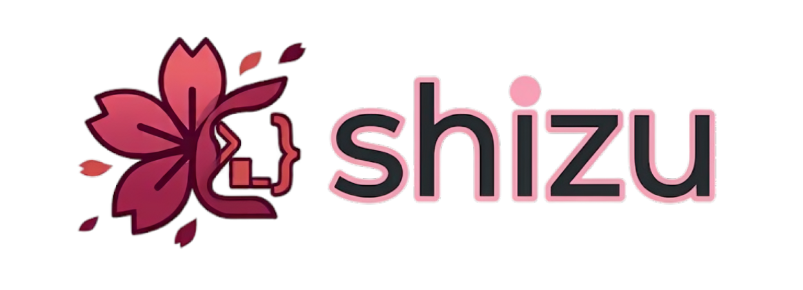
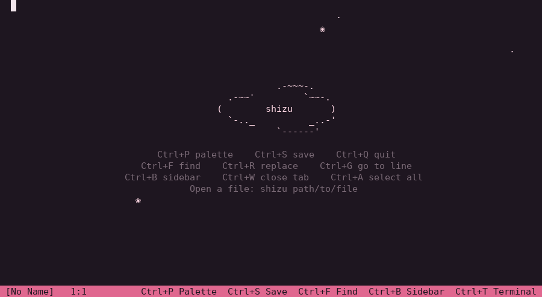

<p align="center"></p>

<p align="center">
  <strong>A modeless terminal text editor with tree-sitter highlighting.</strong><br />
  It edits like nano and highlights like Helix, in a single Rust binary
  with no plugins and a config that's only three keys.
</p>

<p align="center">
  
  
  
  
  
  
</p>

<p align="center">
  <a href="#why-shizu">Why shizu</a> ·
  <a href="#install">Install</a> ·
  <a href="#features">Features</a> ·
  <a href="#keys">Keys</a> ·
  <a href="#configuration">Configuration</a> ·
  <a href="#how-it-works">How it works</a> ·
  <a href="#embedded-terminal">Terminal</a> ·
  <a href="#testing">Testing</a> ·
  <a href="#non-goals">Non-goals</a>
</p>

---

<p align="center"></p>

shizu is a text editor that runs in a terminal. It keeps nano's modeless
editing but uses tree-sitter for syntax highlighting, and unlike Helix you never
switch modes to select, search, or save. It exists because I wanted the
highlighting of a modal editor with the keybindings I already know, plus a theme
that isn't an afterthought.

It's built for people who work over SSH and want a capable editor without a
plugin setup: one executable, no config file required, and a feature set you can
hold in your head.

**Status: pre-1.0.** Editing, saving, search, undo, syntax highlighting, themes,
animation, a file tree sidebar, tabs, and a bottom terminal pane are
implemented. Interactive behavior is verified on Linux; the Windows and macOS
code paths are written but untested.

## Contents

| | |
|---|---|
| [**Why shizu**](#why-shizu) | [**Configuration**](#configuration) |
| [**Install**](#install) | [**How it works**](#how-it-works) |
| [**Features**](#features) | [**Embedded terminal**](#embedded-terminal) |
| [**Keys**](#keys) | [**Testing**](#testing) |
| [**Tech stack**](#tech-stack) | [**Non-goals & known limits**](#non-goals) |

## Why shizu

| Editor | Modeless | Tree-sitter | Plugins | Where shizu differs |
|---|---|---|---|---|
| **nano** | yes | no | no | Same feel, plus tree-sitter parsing, its own themes, and selection and mouse handling that don't feel bolted on. |
| **micro** | yes | no | yes | No plugin system. The entire config is three keys. |
| **Helix** | no (modal) | yes | no | Helix has a better structural editing model, but shizu never makes you change modes. |

The editor is one Rust executable. It runs without a config file, though you can
add one for the theme, tab width, and animation.

## Tech stack

| Layer | Technology | Role |
|-------|-----------|------|
| Text | **ropey** | Rope-backed buffers and cheap line access |
| Terminal | **ratatui** + **crossterm** | Rendering, input, mouse, alternate screen |
| Embedded terminal | **portable-pty** + **vt100** | Shell PTY, emulation, bottom pane rendering |
| Highlighting | **tree-sitter** | Incremental parsing with per-language grammars |
| Clipboard | **arboard** | System clipboard integration |
| Config | **serde** + **toml** | Optional theme, tab-width, and animation file |

## Install

shizu isn't on crates.io. Install straight from the repository:

```sh
cargo install --git https://github.com/lazzerex/shizu.git
```

Or build a release binary from a checkout:

```sh
git clone https://github.com/lazzerex/shizu.git
cd shizu
cargo build --release
./target/release/shizu path/to/file
```

Starting without a path opens an empty buffer.

## Features

**Editing**

- Modeless editing with selection, cut, copy, paste, undo, redo, and line moves.
- Incremental find, replace, replace-all, and go to line.
- Mouse click, drag, and wheel.
- Preserves LF/CRLF and the final newline.
- Saves through a temporary file and rename, detects changes on disk before
  saving, and refuses read-only files or invalid UTF-8.

**Highlighting and themes**

- Syntax highlighting for Rust, JSON, TOML, Python, JavaScript, JSX, TypeScript,
  TSX, Go, C, and Bash.
- Two themes, `sakura` and `sakura-light`, with truecolor and 256-color
  palettes and a plain style for `NO_COLOR`.
- A cherry-blossom welcome screen and optional drifting petals that never cover
  text.

**Workspace**

- A gitignore-aware file tree sidebar with keyboard and mouse navigation.
- Multiple buffers with tabs that reuse an already-open file.
- A fuzzy command palette over files and commands, with context hints in the
  status bar.
- A bottom terminal pane running your shell through a PTY, with keys forwarded
  to it.

## Keys

| Key | Action |
| --- | --- |
| Arrows, Home, End, PageUp, PageDown | Move the cursor |
| Shift plus a movement key | Extend the selection |
| Alt+Up, Alt+Down | Move the current line |
| Ctrl+A | Select all |
| Ctrl+X, Ctrl+C, Ctrl+V | Cut, copy, paste |
| Ctrl+Z, Ctrl+Y | Undo, redo |
| Ctrl+S | Save |
| Ctrl+Q | Quit, with confirmation when dirty |
| Ctrl+F | Find |
| Ctrl+R | Replace |
| Ctrl+G | Go to line |
| Ctrl+P | Open the command palette |
| Ctrl+B | Show or hide the file tree |
| Ctrl+T | Show or hide the terminal pane |
| Ctrl+W | Close the current tab, with confirmation when dirty |
| Ctrl+PageDown, Ctrl+PageUp | Next tab, previous tab |
| F3, Shift+F3 | Next match, previous match |
| Esc | Close the prompt or cancel |

In the find prompt, Enter goes to the next match and Ctrl+P goes to the previous
one. In the replace prompt, Tab switches between the find and replace fields,
and Ctrl+A replaces all matches.

### File tree and tabs

The file tree opens at the current buffer's directory. Use the arrow keys to
move, Right to expand a directory, Left to collapse it, and Enter to open a
file. Clicking a row also opens it. The tab bar appears once more than one
buffer is open, and clicking a tab switches to it; opening a file that is
already open selects its existing tab.

### Command palette

The command palette opens at the buffer's directory. Type to fuzzy-match files,
prefix the query with `>` to search commands instead, and press Enter to run the
selected entry. Ctrl+P, Ctrl+S, Ctrl+F, Ctrl+B, Ctrl+T, and Ctrl+Q are shown in
the status bar for the current focus.

## Configuration

The config file is optional. Missing files use the defaults.

| Platform | Path |
|---|---|
| Linux and macOS | `$XDG_CONFIG_HOME/shizu/config.toml`, falling back to `~/.config/shizu/config.toml` |
| Windows | `%APPDATA%\shizu\config.toml` |

```toml
theme = "sakura"
tab_width = 4
animation = "idle"
```

| Key | Values | Notes |
|---|---|---|
| `theme` | `sakura`, `sakura-light` | An unknown theme falls back to `sakura` and shows a message on the status bar. |
| `tab_width` | integer | Clamped to at least 1. |
| `animation` | `off`, `welcome`, `idle` | Default is `idle`. |

Color depth comes from the environment: `NO_COLOR` selects plain styles,
`COLORTERM=truecolor` or `COLORTERM=24bit` selects truecolor, and otherwise the
256-color palette is used.

### Animation

- `idle` (default): the welcome screen animates, and while editing, petals drift
  over empty cells after five seconds without a key, click, or scroll.
- `welcome`: animates only the empty start screen.
- `off`: disables animation completely.

Petals never cover text, the selection, the cursor, or the status bar. When the
locale is not UTF-8, petals use the ASCII fallback `.`, `*`, and `'`.

## How it works

Input flows through one path:

```
crossterm event
  -> Event
  -> keymap::resolve        (key/mouse tables, focus-aware)
  -> Command
  -> Editor::apply          (mutates buffer and view)
  -> ui::draw               (renders the result)
```

The command enum is the seam between input and editing logic, which is why the
same actions work from keys and the mouse.

- **Buffer.** Rope-backed, and the cursor moves by grapheme cluster rather than
  byte or `char`. Layout uses display width, so wide characters and tabs line
  up.
- **Saving.** Saves write a temporary file in the same directory, sync it, and
  rename it over the target. The original is never truncated in place.
- **Highlighting.** Parses a 128-line block around the viewport plus 64 lines of
  context, and caches spans by buffer revision and window. Cost stays bounded
  as files grow, at the price of context at the top of the window.

### Source layout

```text
src/
  main.rs          terminal setup, event loop, panic-safe restore
  buffer.rs        rope, transactions, load and atomic save
  view.rs          cursor, selection, scroll, layout columns
  editor/          command dispatch, movement, editing, prompts
  keymap.rs        key and mouse tables, focus-aware resolution
  search.rs        pure literal matcher
  syntax/          language registry and highlight cache
  anim.rs          welcome screen petals, idle timer, glyph fallback
  theme.rs         palettes, color depth, contrast, styles
  config.rs        optional TOML config
  tree.rs          gitignore-aware file tree state
  palette.rs       fuzzy palette state and file listing
  terminal/        PTY process, vt100 pane, key encoding, rendering
  ui/              frame, status bar, sidebar, palette, tab, and terminal rendering
examples/
  terminal_spike.rs  standalone PTY and emulator pane
```

## Embedded terminal

Ctrl+T opens a terminal pane across the bottom of the window, focused on a new
shell. It runs the platform default shell through `portable-pty`, feeds output
into `vt100`, forwards keys, and resizes the PTY when the pane changes size.

- While the pane has focus, keys are encoded and sent to the PTY. Ctrl+T closes
  the pane and kills the shell.
- Clicking the text area returns focus to the editor without closing the pane.

`vt100` is the emulator decision. It provides the visible cell grid, cursor,
colors, attributes, and alternate screen with a smaller dependency and API than
`alacritty_terminal`. Scrollback and reflow are not needed for the pane, so the
heavier emulator is not justified.

The standalone spike opens the same pane without the editor and closes on
`Ctrl+Q`:

```sh
cargo run --example terminal_spike
```

## Testing

```sh
cargo fmt --check
cargo clippy --all-targets -- -D warnings
cargo test
```

There are 267 unit and render tests covering buffer edits, save behavior,
scrolling, keymap resolution, selection, undo, search, themes, highlighting,
animation, tabs, the file tree, the command palette, and the terminal pane. The
PTY session is exercised with a real PTY on Linux.

Still needing manual checks: interactive behavior on Windows and macOS,
clipboard interop, a crash during save, and the terminal pane in a real
terminal.

## Non-goals

shizu won't become a full IDE. There's no debugger, build runner, or project
management, and no plugin scripting language. It won't do modal editing. It
won't add telemetry, ads, or auto-updates.

## Known limits

- A block comment or string longer than 64 lines can lose color at the top of the
  highlight window, because highlighting starts from a nearby line rather than
  the beginning of the file.
- Embedded languages aren't re-highlighted. An expression inside a Python
  f-string or a command substitution in Bash uses the outer scope.
- C++ isn't supported, and `.h` files are treated as C. Only the C grammar is
  installed.
- A new buffer with no path can't be saved yet; save reports that there is no
  path.
- Windows and macOS key handling, mouse behavior, and clipboard integration are
  untested on those systems.
- Split panes are not implemented; the terminal is a single fixed bottom pane.
  Terminal query replies, mouse forwarding, scrollback rendering, and clipboard
  integration are not implemented, and there's no language server support yet.
